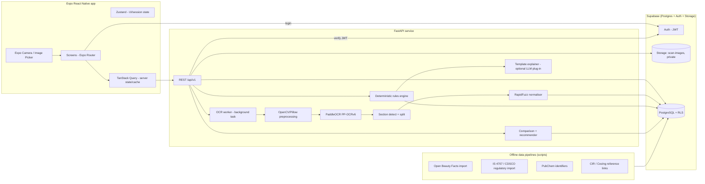
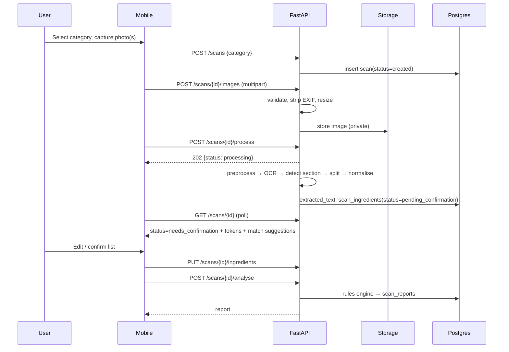

# 02 · System Architecture

## 1. Component diagram

## 2. Scan sequence

## 3. Scan state machine
`created → images_uploaded → processing → needs_confirmation → confirmed → analysed` ; side exits: `ocr_failed`, `no_ingredients_found` (both let the user type/paste the list manually and continue).

## 4. OCR + parsing pipeline
1. **Validate** (magic bytes, size, dimensions, decode test). HEIC converted server-side.
2. **Preprocess** (OpenCV): EXIF-orient, resize long edge ≤ 2000 px, greyscale, CLAHE, light denoise, skew estimate (Hough/minAreaRect) and rotate. Blur score (variance of Laplacian) → warn user, never block.
3. **OCR** (PaddleOCR PP-OCRv6, English): detection + recognition + angle classifier; keep boxes, text, confidence. Multiple images → run each, keep per-image text; merge only after section detection.
4. **Section detection**: header regex set (`ingredients`, `ingredient list`, `composition`, `contents`, `inci`, …); end markers (`directions`, `how to use`, `warning`, `manufactured by`, `mfg`, `batch`, `best before`, `net wt`, …). Fallback: highest comma-density block. Output includes `section_confidence` and `section_complete` boolean.
5. **Clean**: unicode normalise, join hyphen-wrapped lines, repair OCR confusions only inside matching (never rewrite displayed raw text), keep raw and cleaned.
6. **Split**: commas/semicolons/bullets at bracket depth 0; handle `Aqua (Water)`, `Parfum/Fragrance`, `CI 77891`, `May contain +/- …` blocks, `Contains permitted colours` statements (kept as statements, not ingredients).
7. **Normalise**: (a) exact canonical/INCI; (b) exact synonym; (c) RapidFuzz `WRatio`/`token_set_ratio` against candidate index. Initial thresholds (to be tuned on real Indian labels in M3/M4): ≥ 95 auto-match; 80–94 "did you mean" (needs user accept); < 80 unmatched. Store candidates and scores.
8. **Confidence**: per-token `ocr_conf × match_score`; list-level flags: section_complete, blur_warning, unmatched_ratio. Nothing is ever invented to fill gaps.

## 5. Rules engine (M4)
Inputs: confirmed ingredient IDs, product category (leave-on/rinse-off/sun/etc. derived), user preferences. Data: `ingredient_assessments`, `ingredient_regulations`, `ingredient_sources`. Output per ingredient: class (1–6), reasons[], citations[], regulation records[], preference flags[], confidence. Pure functions, versioned ruleset id stored with every report so old reports remain reproducible.

Templated natural-language explanation assembled from stored fields. Optional LLM explainer: interface `Explainer.explain(structured_result) -> str`, may only rephrase supplied fields; disabled by default (FR-20).

## 6. Comparison & recommendation (M6)
Hard filters: same category, compatible function, product ingredient list marked complete, verification ≥ VERIFIED (COMMUNITY_SUBMITTED only if user opts in, labelled). Soft ranking: preference match, class distribution, shared-function coverage. Every result carries `reasons[]`. Empty result is a valid first-class response. No price/availability fields exist in the schema.

## 7. Security architecture
- Supabase Auth issues JWTs; FastAPI verifies signature/audience/expiry (JWKS) on every request.
- **RLS enforced for user data even through the API:** the API connects with a restricted DB role (not `service_role`, no BYPASSRLS) and sets `request.jwt.claims` per transaction (`SET LOCAL`), so policies protect data even if an endpoint has a bug. A separate admin role is used only by import scripts.
- Storage bucket `scan-images` private; paths `{user_id}/{scan_id}/{uuid}.jpg`; access via short-lived signed URLs.
- Upload hardening: size caps, decode-and-re-encode (kills polyglots), rate limits per user, EXIF/GPS strip.
- Secrets in env only; `.env.example` committed, `.env` ignored; gitleaks in CI.
- Logging excludes raw OCR text and tokens at INFO.

## 8. Schema ownership
**Alembic is the only migration system** (SQLAlchemy models are source of truth, RLS policies are raw-SQL migrations). Supabase local stack is used for Postgres/Auth/Storage only; the `supabase/migrations` directory stays empty to avoid two competing histories. (D-005)

## 9. Extensibility
- `domain` column (`cosmetics` | `food`) on categories and ingredients; separate assessment/regulation tables are keyed by `domain` and `jurisdiction` so FSSAI logic slots in without touching cosmetics rules.
- `language` column on `scans`/`extracted_text`; OCR engine behind `OcrEngine` interface (`recognise(image, lang)`).
- Rules engine registered per domain: `RulesEngine[cosmetics]`, later `RulesEngine[food]`.

## 10. Deployment shape (documented, not built)
Mobile: EAS Build (free tier has queue limits — verify). API: container with PaddleOCR needs roughly ≥2 GB RAM; truly free always-on hosting for this is the weakest point of a ₹0 plan (see risk R-09, decision D-008). Database/Auth/Storage: Supabase Free (limits in doc 06).
